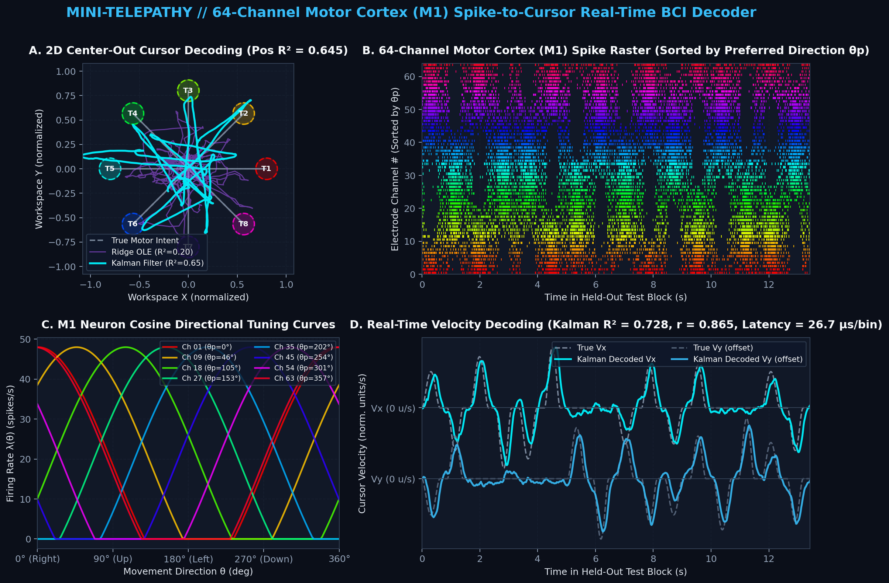
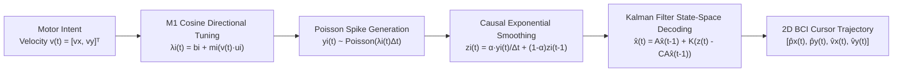

# 🧠 Mini-Telepathy: Motor Cortex (M1) Spike-to-Cursor BCI Simulator & Decoder

[](#)
[](#2-zero-dependency-real-time-web-studio-recommended)
[](#)
[](LICENSE)

> **Reproduces the core algorithmic pipeline of Neuralink's "Telepathy" brain-computer interface**: from the action-potential spikes recorded by a 64-channel motor cortex (M1) microelectrode array, it decodes 2D on-screen cursor velocity and movement trajectory in real time using a state-space **Kalman filter** and an **optimal linear estimator (Ridge OLE)**.



---

## ✨ Key Highlights

1. **End-to-End Biophysical M1 Simulation**:
   - Generates an 8-direction radial **center-out reaching task** from the **minimum-jerk trajectory** model of **Flash & Hogan (1985)**.
   - Simulates spikes on 64 microelectrode channels using the **cosine directional tuning** law of motor cortex neurons from **Georgopoulos et al. (1986)** together with an **inhomogeneous Poisson process**.
2. **Two Classic, Clinical-Grade Invasive BCI Decoders**:
   - **State-Space Kalman Filter (`KalmanFilterDecoder`)**: uses the matrix inversion lemma (Woodbury identity) for ultra-low-latency recursive state updates of **$< 30\,\mu\text{s}$** per step, smoothly tracking $[p_x, p_y, v_x, v_y]^\top$.
   - **Multi-Lag Ridge Wiener Filter (`RidgeVelocityDecoder`)**: an $L_2$-regularized optimal linear decoder that fuses a window of firing-rate history spanning multiple time steps.
3. **Out-of-the-Box in Two Forms (Python scientific stack + zero-dependency real-time web studio)**:
   - **`demo.py`**: runs 32 calibration trials plus an 8-trial held-out test evaluation in one command, prints a table of quantitative metrics, and renders a 4-panel publication-grade summary figure.
   - **`index.html`**: needs no installation. Double-click it, or open it on **GitHub Pages**, to get a 60 FPS real-time neural decoding console with an **"Auto Center-Out"** mode and an **"Interactive Intent"** mode (control the cursor with your mouse)!

---

## 🔬 Mathematical Formulation



### 1. Encoding Model: Cosine Directional Tuning of M1 Neurons
The $i$-th neuron in primary motor cortex (M1) has a specific preferred direction angle $\theta_{p,i} \in [0, 2\pi)$ (corresponding to the unit direction vector $\mathbf{u}_i = [\cos\theta_{p,i}, \sin\theta_{p,i}]^\top$). When the subject intends to move the cursor with velocity $\mathbf{v}(t) = [v_x(t), v_y(t)]^\top$, the neuron's instantaneous firing rate $\lambda_i(t)$ follows a cosine tuning relationship:

$$\lambda_i(t) = \max\Big(0,\; b_i + m_i \big(\mathbf{v}(t) \cdot \mathbf{u}_i\big) + s_i \|\mathbf{v}(t)\|_2 + \epsilon_i(t)\Big)$$

Here $b_i$ is the baseline firing rate (Hz) and $m_i$ is the directional modulation depth (Hz). The spike count within a time window of $\Delta t = 20\text{ ms}$ follows a Poisson distribution, $y_i(t) \sim \text{Poisson}(\lambda_i(t)\Delta t)$.

### 2. Kalman Filter Decoding (State-Space Model)
Define the motor state vector at time $t$ as $\mathbf{x}_t = [p_x(t), p_y(t), v_x(t), v_y(t)]^\top \in \mathbb{R}^4$, and the multi-channel smoothed firing-rate observation vector as $\mathbf{z}_t \in \mathbb{R}^{64}$:

$$\begin{aligned}
\text{State Transition:} \quad \mathbf{x}_t &= \mathbf{A}\mathbf{x}_{t-1} + \mathbf{w}_t, \quad \mathbf{w}_t \sim \mathcal{N}(\mathbf{0}, \mathbf{W}) \\
\text{Neural Observation:} \quad \mathbf{z}_t &= \mathbf{C}\mathbf{x}_t + \mathbf{q}_t, \quad \mathbf{q}_t \sim \mathcal{N}(\mathbf{0}, \mathbf{Q})
\end{aligned}$$

During the calibration phase (calibration trials), the parameter matrices $(\mathbf{A}, \mathbf{W}, \mathbf{C}, \mathbf{Q})$ are fitted by closed-form maximum likelihood estimation (MLE). During real-time decoding, recursive predict-update steps output the optimal estimates of cursor position and velocity.

---

## 🚀 Quickstart

### 1. Run the End-to-End Python Decoding Pipeline and Benchmark
```bash
# 1. Enter the project directory and install dependencies
cd mini-telepathy
pip install -r requirements.txt

# 2. Run calibration, testing, and generation of the 4-panel summary figure
python demo.py
```

The terminal prints a quantitative performance comparison on the held-out test split. The table below comes from one local simulation run of `python demo.py` (random seed `42`); the full results are in [`assets/benchmark_summary.txt`](assets/benchmark_summary.txt). Latency varies with hardware and runtime environment.

| Decoder Algorithm | Vel $R^2$ | Pos $R^2$ | Pearson $r$ | Vel RMSE | Latency / bin |
| :--- | :---: | :---: | :---: | :---: | :---: |
| **Kalman Filter (State-Space)** | 0.728 | 0.645 | 0.865 | 0.490 | 26.7 µs |
| **Ridge OLE (5-Lag Wiener)** | 0.953 | 0.200 | 0.977 | 0.203 | 4.7 µs |

### 2. Zero-Dependency Real-Time Web Studio (Recommended)
Open [`index.html`](index.html) in the repository root directly in your browser (or push the repository to GitHub and enable **GitHub Pages**):
- **🎯 Auto Center-Out mode**: watch how the spikes from 64 channels drive the cursor in real time to capture targets in 8 directions, while the Fitts's-law BCI communication bit rate (bps) is computed live.
- **🖱️ Interactive Intent mode**: move your mouse inside the arena on the left to stand in for your "motor cortex intent". The system encodes it in real time into noisy spikes on 64 channels, and the Kalman filter decodes them to recover the glowing blue BCI cursor!
- **Live parameter tuning**: drag the sliders to adjust the spike smoothing time constant $\tau$, the background neural noise $\sigma$, and the decoder gain $K$, and get an intuitive feel for the engineering trade-off between signal-to-noise ratio and response latency.

---

## 📂 Repository Structure

```text
mini-telepathy/
├── index.html                  # Zero-dependency HTML5 real-time BCI simulation & decoding studio (GitHub Pages ready)
├── demo.py                     # One-command Python script for end-to-end training, evaluation, and 4-panel visualization
├── requirements.txt            # Python scientific computing dependencies (numpy, matplotlib)
├── src/
│   ├── __init__.py
│   ├── simulator.py            # M1 cosine-tuning spike simulator and minimum-jerk trajectory generator
│   └── decoder.py              # State-space Kalman filter decoder and multi-lag Ridge OLE decoder
├── assets/
│   ├── decoding_result.png     # Auto-generated high-resolution 4-panel decoding figure
│   └── benchmark_summary.txt   # Quantitative evaluation report on the held-out test set
└── LICENSE                     # MIT open-source license
```

---

## 🛣️ Roadmap for Next Versions

If you want to extend this project further, you can add the following modules in order:
- [ ] **Connect to real public macaque BCI datasets**: interface with the real `MC_Maze` data in NWB format from the [Neural Latents Benchmark (NLB)](https://neurallatents.github.io/) or the DANDI Archive.
- [ ] **Nonlinear deep-learning decoders**: add lightweight `GRU` / `LSTM` or `Causal Transformer` decoders and compare them head-to-head with the Kalman filter.
- [ ] **Adaptive recalibration for neural non-stationarity (Closed-Loop Recalibration)**: simulate the across-day signal drift (neural drift) caused by microelectrode micro-displacement, and implement unsupervised self-recalibration.
